# **WEEK 1**

De checkout vragen 9/11/26:

1. Leg uit wat een source hosting platform is en voor welke jij gekozen hebt.
   Een source hosting platform is het platform waarop jouw website uiteindelijk komt te staan. Degene die ik heb gekozen is Github, omdat het gemakkelijk gaat en iedereen die gebruikt.
2. Vertel welke domeinnaam jij gekozen hebt en hoe je die hebt gekoppeld aan jouw pagina.
   Mijn domeinnaam heet 'Paschas-cottage' en die heb ik gekoppeld door middel van inloggen via Github en het koppelen met de VSCodium. Daarnaast was het ook wat gesleutel met instellingen.
3. Beschrijf hoe je aanpassingen aan jouw pagina kunt maken en hoe je er voor zorgt dat die op het web gepubliceerd worden.
   Je download sowieso de 'go-live' extension maar daarnaast zorg je er vooral voor dat je github is gekoppeld aan je VSCodium.

Lelijke pagina opdracht

Proces opdracht
De opdracht is in tweeën verdeelt; een voorbereidings onderdeel die je voor de les maakt en het onderdeel dat we samen tijdens de les hebben gedaan.
Vooraf kreeg je de opdracht om een aantal dingen in een website te doen, maar op de manier dat het niet erg prettig is om naar te kijken. Dit deed je met het programma Codepen, die gekoppeld is aan je Github account. Hierbij deed je je eigen gekozen tekst in de template (titels en broodtekst) en een afbeelding.
Tijdens de les gingen we dingen toevoegen, zoals kleur, linkjes en een invulformulier. Zo veranderde de 'lelijke' pagina naar een iets minder lelijke pagina.

Wat heb ik geleerd

- Hoe je een invul formulier toevoegt
- Hoe je iets linkt
  

Wat is handig om mee te nemen naar volgende stap:

- Hoe je een pagina mooier maakt
- Kunnen linken/formulier toevoegen (als dat bij mijn concept past)

CSS dive oefeningen
Proces opdrachten
Vooraf was het huiswerk om een code game te spelen om alvast een introductie te krijgen met het coderen en oplossen. Hierdoor kreeg ik minder het gevoel dat ik in het diepe werd gegooid en ik vond het ook nog eens een leuke oefening (wel eerst frustrerend).
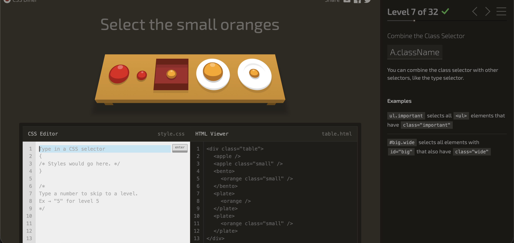

Daarna waren er twee opdrachten die we tijdens de les die we samen gingen doen. Ik vind het wel fijn dat dit soort dingen in de les worden uitgelegd in plaats van dat het online maar ergens staat.
De eerste oefening was om een tekstje hetzelfde te maken. Ik vond het opzich wel te doen omdat het geen grote veranderingen waren en dus heb ik ook niet hoeven te spieken bij het voorbeeld.

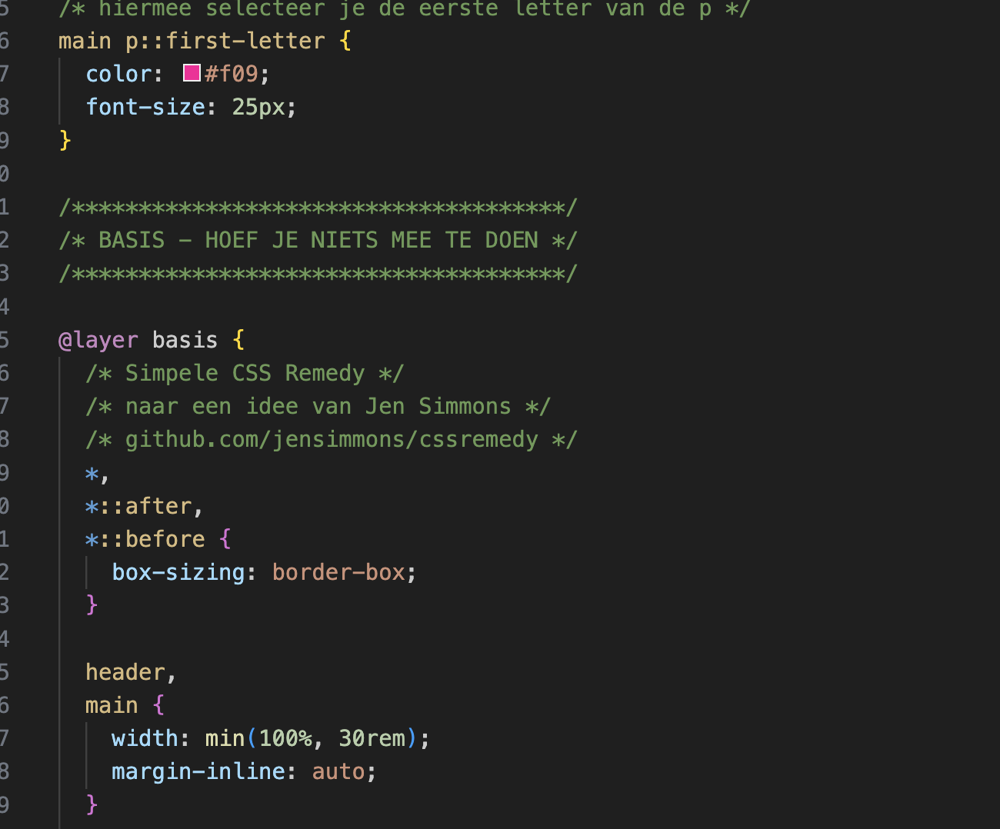
De tweede oefening was ook weer om twee dingen met een titel na te maken. Dit is mij meerendeels gelukt waarbij ik soms wel moest spieken omdat ik sommige codes niet herkende.
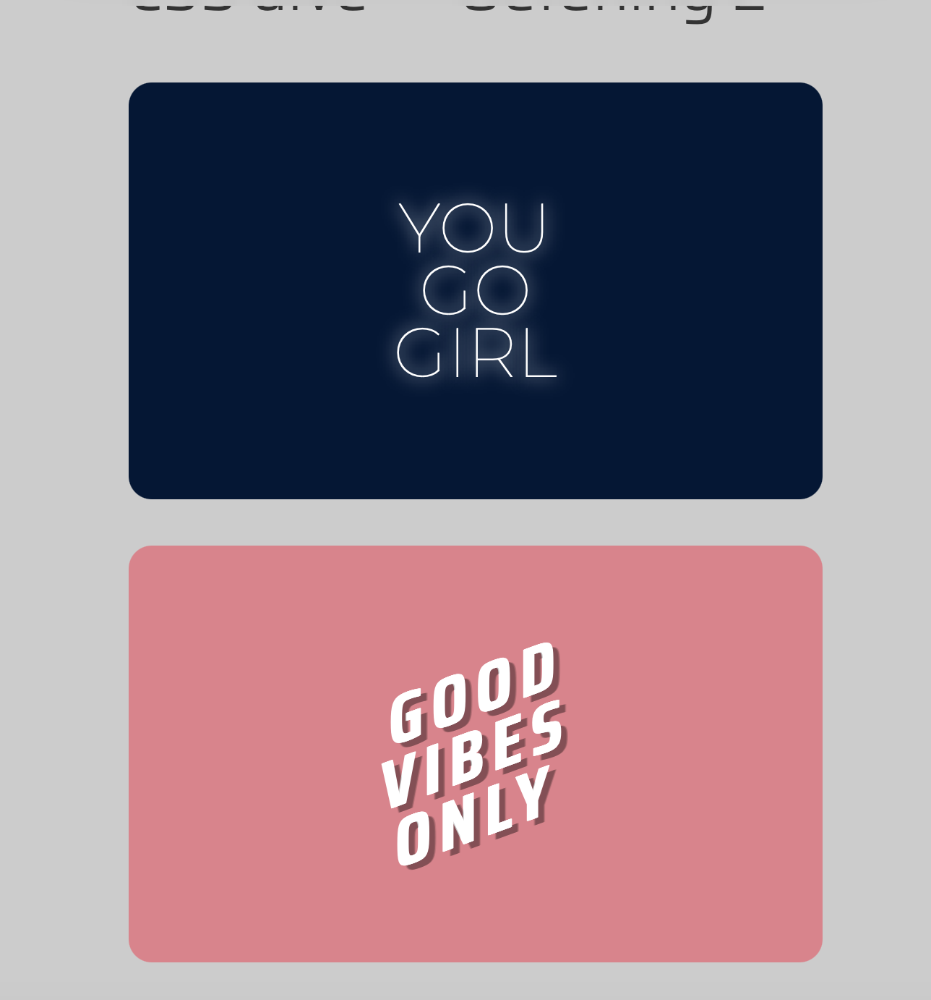
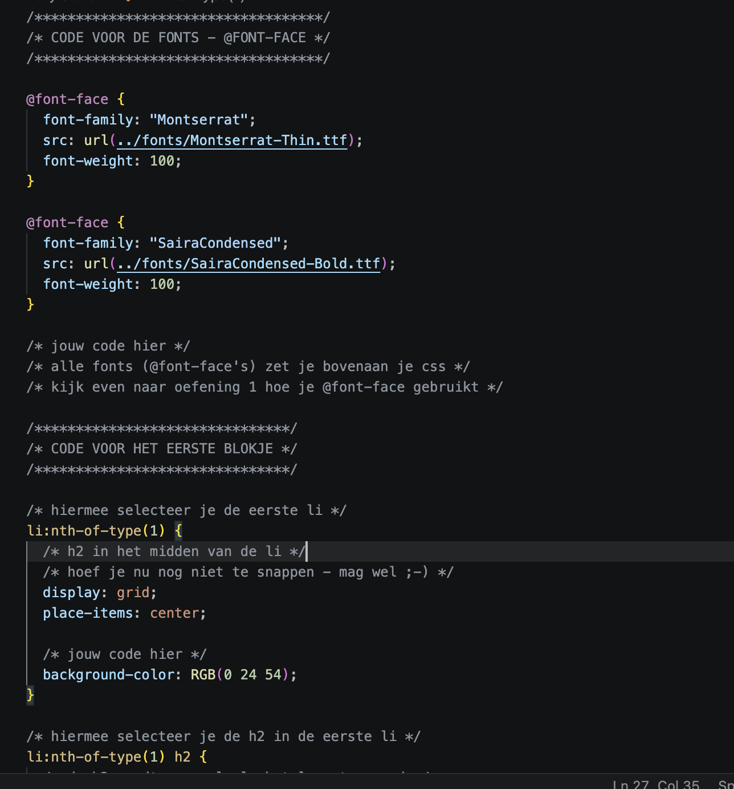

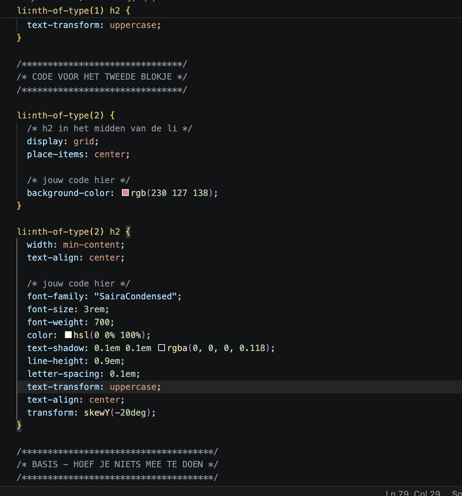

Wat heb ik geleerd en wat ik zou kunnen toepassen

- Grote eerste letter in de tekst (uit oefening 1)
- Tekst schuin maken (uit oefening 2)
- Een glow geven aan de tekst (uit oefening 2)

Schetsen oefening
Proces opdrachten
Ter voorbereiding had ik schetsen meegenomen van eerdere blokken en liet die beoordelen door mn medestudenten met goed, mid en slechst. Ik vond het fijn om te weten wat anderen van mijn schetsen vonden.
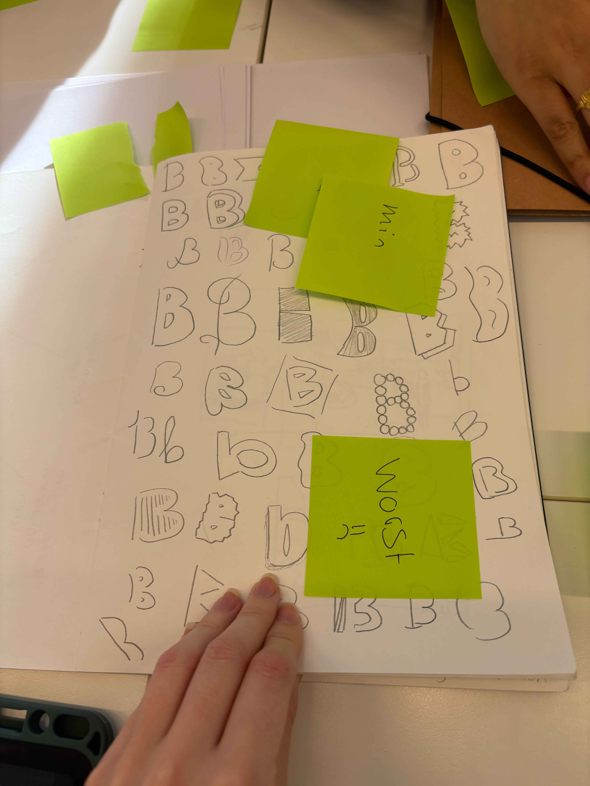
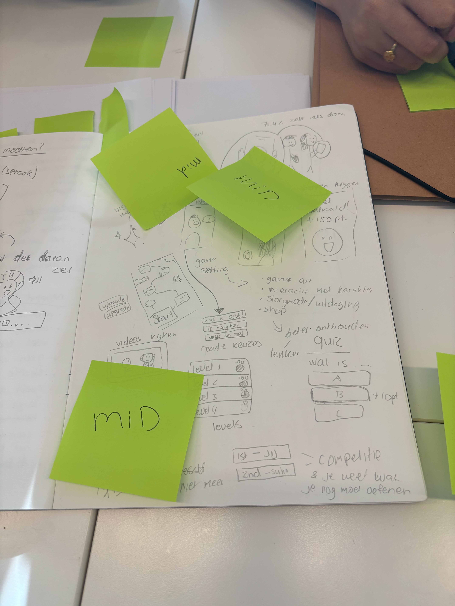

Daarna deden we wat schetsopdrachtjes, zoals het maken van gelijke strepen en vierkanten en telefoons om te oefenen met vormen. Dit hielp mij met het uiteindelijk maken van een telefoon formaat van een zelf gekozen app. Hierbij keek je dan ook naar schaduwen en hierarchie, wat belangrijk is met het laten zien van waar de bezoeker naar kan kijken. Ik heb voor letterboxd gekozen; deze heeft een goede verdeling van tekst en afbeeldingen. Er werd ook gezegd om niet een kruis in de afbeelding te maken maar om kort de afbeelding te schetsen. Zo heb je een beter beeld bij wat de afbeelding is.
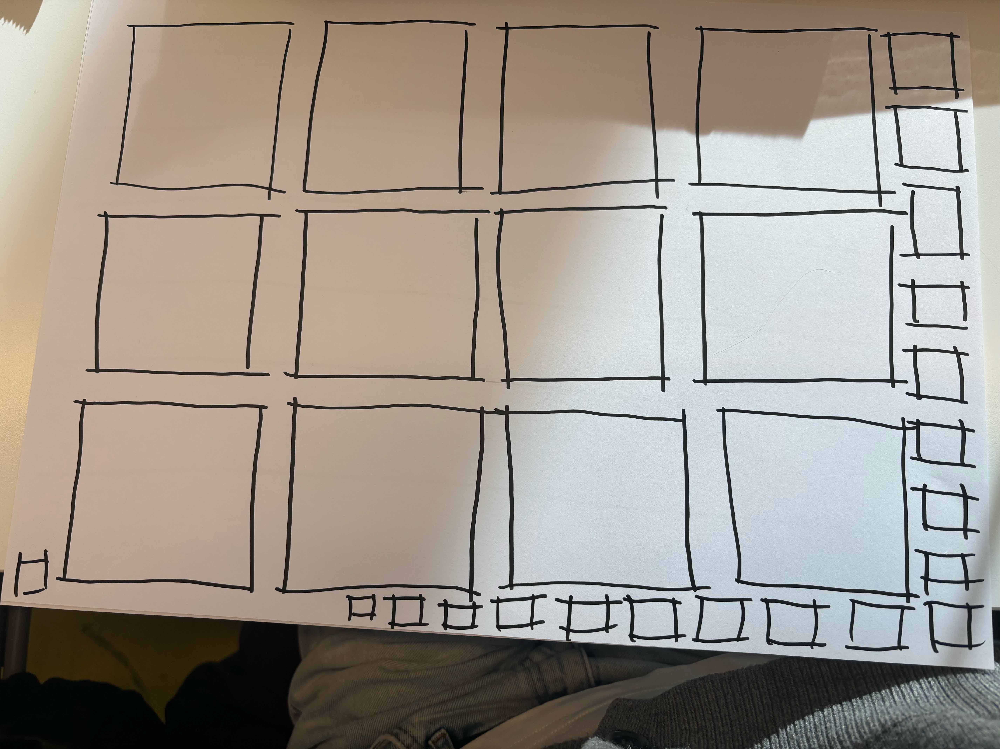
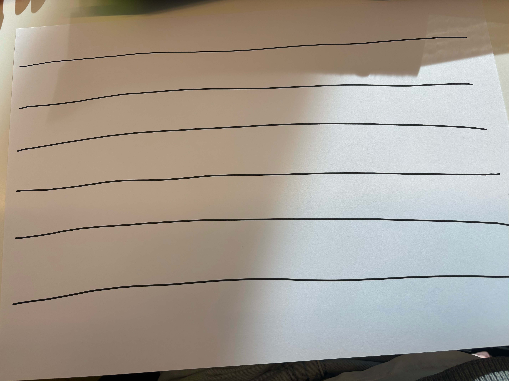
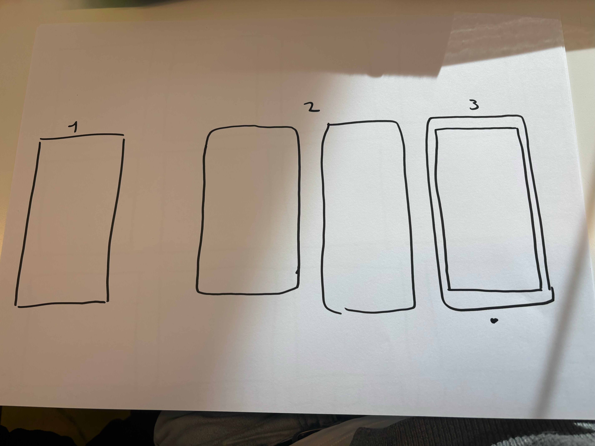

Als laatste heb ik bij de schets van een wok-menu, die ik bij Nicky's les had gemaakt, een animatie toegevoegd. Hierbij maakte ik ook weer gebruik van de kleuren en vormen en proces van hoe de animatie tot stand komt. Dit is handig om te weten als je wilt laten zien wat de animaties zijn.
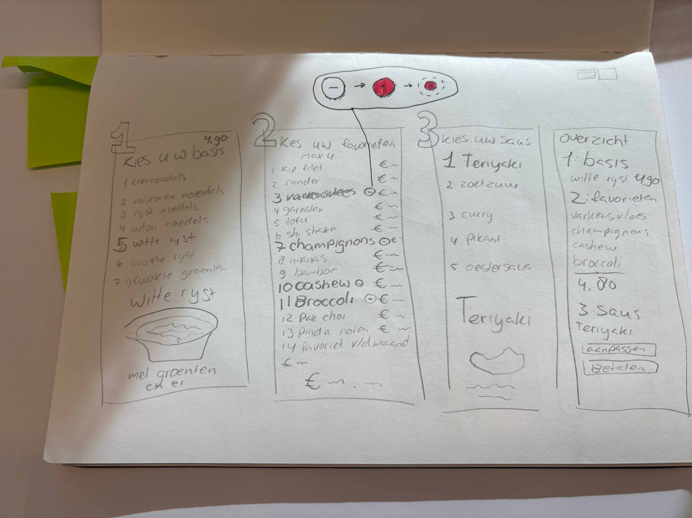

Wat heb ik geleerd en kan ik meenemen naar de volgende iteratie

- Animatie schetsen
- Hoe je vierkantjes maakt (4 lijnen en niet in één lijn)
- Gebruik van hierarchie

# **WEEK 2**

De checkout vragen voor maandag 16-11-26:

1. Leg uit wat een digital garden is en waarom dat anders is dan een reguliere website.
   Een digital garden blijft zich aanpassen en is iets persoonlijks. Ook heeft het niet één doel en is voor iedereen anders en een reguliere website heeft één doel.
2. Leg uit wat een website 'webby' maakt en welke websites jou het meeste inspireren.
   Onderdelen voor een webby zijn:

- Duidelijke elementen zoals knoppen die groot genoeg zijn
- Genoeg contrast tussen de elementen en kleur
- Haalbaar en duidelijk te maken met CSS en HMTL
- Duidelijke status van de knoppen

3. Vertel waar jij mee aan de slag wilt gaan bij het maken van jouw eigen digital garden (let op: dit zijn jouw eerste ideeën, dit kan en mag veranderen in de loop van het programma)
   Mijn eerste idee gaat over het universum en dat je op de planeten kan klikken en dat je dan informatie krijgt met een thema
   Mijn tweede idee gaat over films en dat je dan een film kan uitkiezen en dat dan de hele pagina die sfeer van die film wordt. Hierbij schrijf ik dan ook mijn mening over de film en de lessen die ik eruit haal.

**Mijn bedachte concepten**

- Film ambiences - bij elke film veranderd kleur font, vormen, evt muziek??? plaatje die ergens draait
- Universum - een overzicht aan planeten en sterren die je kan inzoomen met een telescoop: elk planeet/ster verteld iets anders
- Stripboek waarbij je door het verhaal heen bladert
- Letterlijke garden waarbij je op elementen kan klikken (bv gieter, bloem, kruiwagen) en het elk iets anders laat zien
- Schaakbord waarbij elke pion iets anders verteld/laat zien

Ik had de ‘film ambiences’ en ‘universum’ concepten voorgelegd en besproken met Barbara en Vasilis en ze vonden het beiden allebei goede en orginele concepten, maar misschien kan ik kijken hoe ik het haalbaar kan maken voor deze 10 weken. Barbara benoemde ook dat het cool is als ik iets persoonlijks eraan toevoeg, bijvoorbeeld mijn mening van de films.

**Presentatie en vragenlijst:**
Ik had een presentatie gemaakt over mijn concept (het filmarchief) zodat ik dit kon presenteren aan een medestudenten zodat ik kan oefenen om over mijn concept te vertellen. (zie mapje oefeningen)
Hiervoor heb ik mijn concept onderverdeelt in alle onderdelen die ik wilde benoemen:

- Film aesthetic vertaald
- Inspirerende quotes
- Mijn reviews
- Website elementen

**Eigen verbinding:**

- Heeft 'de ander' een aanvulling op je onderwerp?
  zie het al helemaal voor me, dus goed uitgelegd. ook leuk dat je niet alleen beeld willen gebruiken maar ook geluid. Misschien ook vergelijkbare films laten zien als je eentje hebt gekozen.
- Wat is het karakter/ de uitstraling/ het gevoel dat bij het onderwerp past? (bijv. stoer, hip, vrolijk, dynamisch, eenvoudig, enz.)
  nostalgisch, old cinema/hollywood maar ook sfeervol door alle elementen. Ook moody door de ambience.
- Welke inspiratie kun je uit je 25 afbeeldingen halen. Stijl, een gevoel, vorm, enz.
  het oude terugbrengen voor homepagina en als je dan op de film klikt dat het dan de ambience veranderd. filmrol of spotlight op homepagina houden.
  **Een stip op de horizon**
- Wat zou je willen vertellen over het onderwerp aan een ander? en hoe zou je dat voor je kunnen zien? middels welke beeld, tekst, animatie, inhoudelijke content? (bijv. Ik wil voornamelijk afbeeldingen tonen, als een soort Pinterest, of ik wil muziek fragmenten laten horen, of ik gebruik korte teksten met eigen foto's).
- Vul deze zin aan:Ik wil mijn Digital Garden laten gaan over een film archief met de film ambience en wil dat laten zien door bijpassende kleuren, fonts, afbeeldingen en andere grafische elementen aan content te tonen. Ik begin met een stukje eigen content over films en mijn eigen favorieten. Als het begin is gemaakt kan ik mijn Garden verder uitbreiden door de persoonlijke ambience pagina’s te maken met belangrijke punten die je uit de film kunt halen.

Conclusies

- Onderwerp duidelijk voor de andere
- Voelt moody en dromerig

geinspirereerd → concept: filmarchief → allerlei lessen en inspiratie die je uit films kan halen
emotioneel → concept: filmarchief → films brengen allemaal emoties naar voren
dromerig → films hebben een grote fantasie, van het idee tot de uitwerking van de look-en-feel
artistiek → films zijn heel expressief met hun kunsten

Uiteindelijk kies ik voor dromerig omdat het het beste uitlegt wat voor sfeer films geven: het zijn zoveel gekke verhalen net zoals degene die je in je dromen krijgt. Daarnaast zijn films ook magisch zoals dromen.

**Visual research**
Voor mijn visual research ben ik op zoek gegaan naar abstracte afbeeldingen die mijn sfeerwoord 'dromerig' goed kunnen uitbeelden. Bij het woord kreeg ik een flowy, gradient en moody sfeer die ik heb kunnen terugvinden in beelden. Er zit ook een tintje mysterieusheid achter omdat dromen en films ook wel mysterieus en onvoorspelbaar zijn.
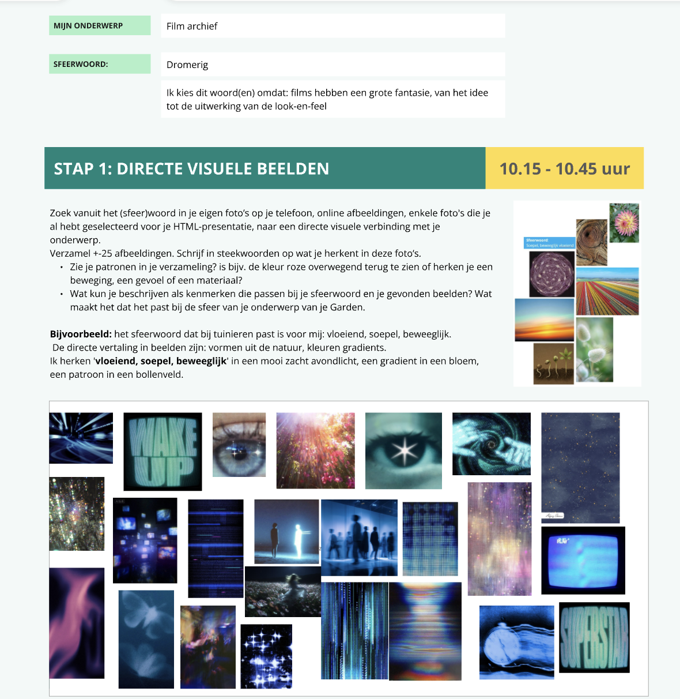
De volgende stap was het vinden van typografie en typografische posters. Ik wilde hiervoor het flowy en gradient terugbrengen. Ook wilde ik niet een dun fontje omdat het dan wegvalt met de gradient en andere elementen. Ik vind dat het aflopende font het erg helpt met de sfeerbepaling en al gelijk een moody, mysterieuze 'vibe' geeft die ik precies wil hebben voor mijn digital garden!
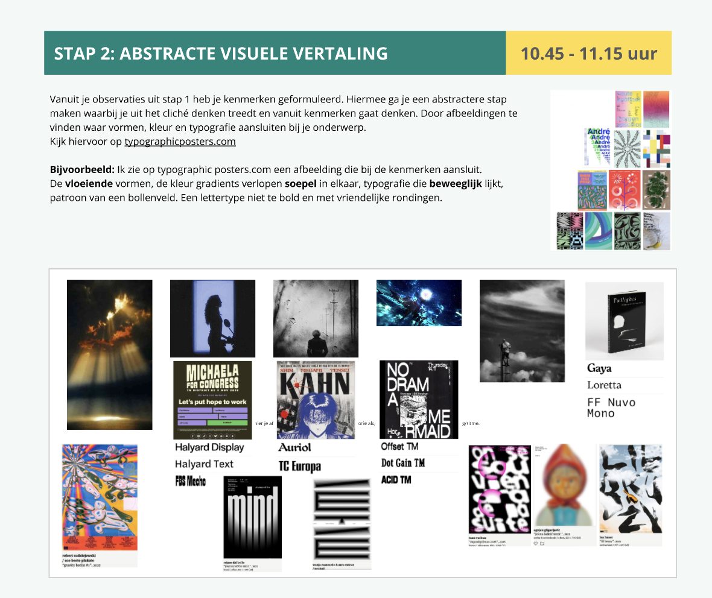
Ik heb de vier meest aansprekende typografische posters uitgekozen en benoemd hoe ik het kan gebruiken voor mijn concept, dus bijvoorbeeld het gebruiken van een blur of een speling van de letters en een duidelijk contrast maken van kleur zodat het niet wegvalt.
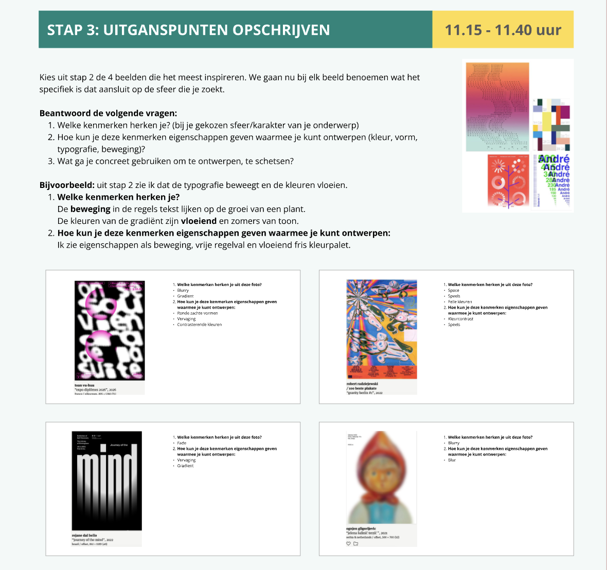

Toen ben ik een crazy 8 gaan maken op basis van deze visual research om mij te helpen met het idee vanuit mijn hoofd op papier te krijgen. Ik dacht hierbij vooral aan het sfeerwoord 'dromerig' en heb dan ook bij sommige wolken of zweverige elementen toegevoegd. Ik zou nog wel verder willen schetsen omdat ik merkte dat ik het lastig vond om mijn concept op papier te zetten en wat het beste idee is.
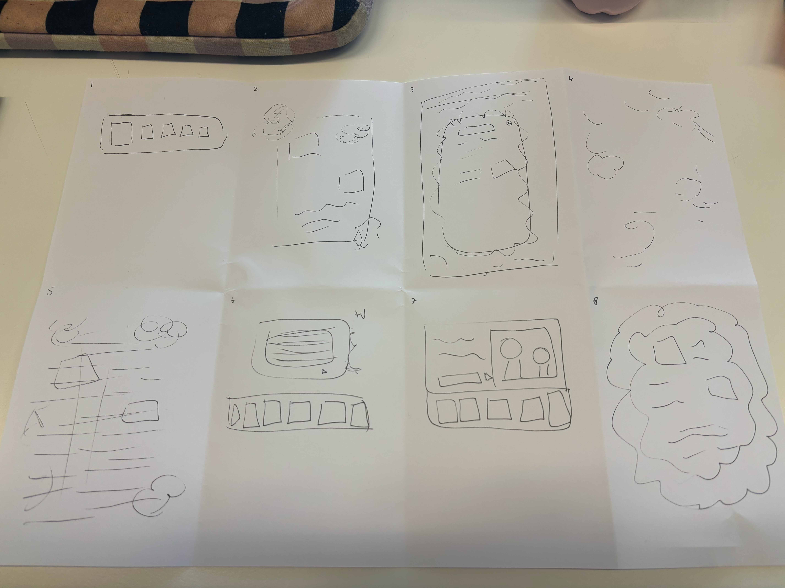
Ik vond het daarom wel fijn om aan een medestudent te vragen welke zij het beste en minst best vond. Uiteindelijk vond zij de opties met het tv'tje en de film keuzes eronder het beste omdat het overzichtelijk was en gelijk duidelijk maakte wat je kon doen. De minst favoriete was die met de wolken omdat die te letterlijk waren en niet goed het moody en mysterieuze naar voren laten komen.
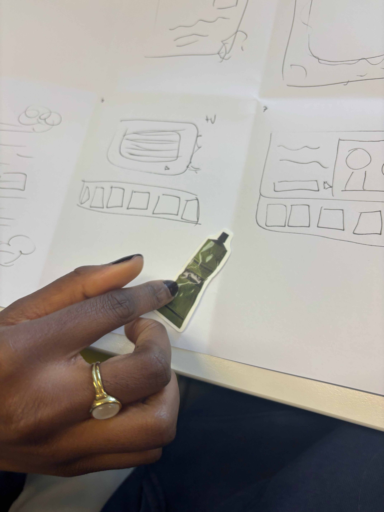

Conclusies

- Niet te letterlijk maken
- Het moet wel duidelijk blijven wat je kan doen
- Gradient en mysterieuze is een goede keuze

Wat neem ik mee naar het volgende

- Gradient
- Aflopend naar vervaging
- Duidelijke hierarchie
- Zwevend

**Analyse websites**
Ik ben in een duo websites gaan analyseren of die webby zijn. Allebei de websites vond ik erg onoverzichtelijk en slordig. Ik vond het uiteindelijk een goed voorbeeld van hoe ik het NIET wil gaan doen.
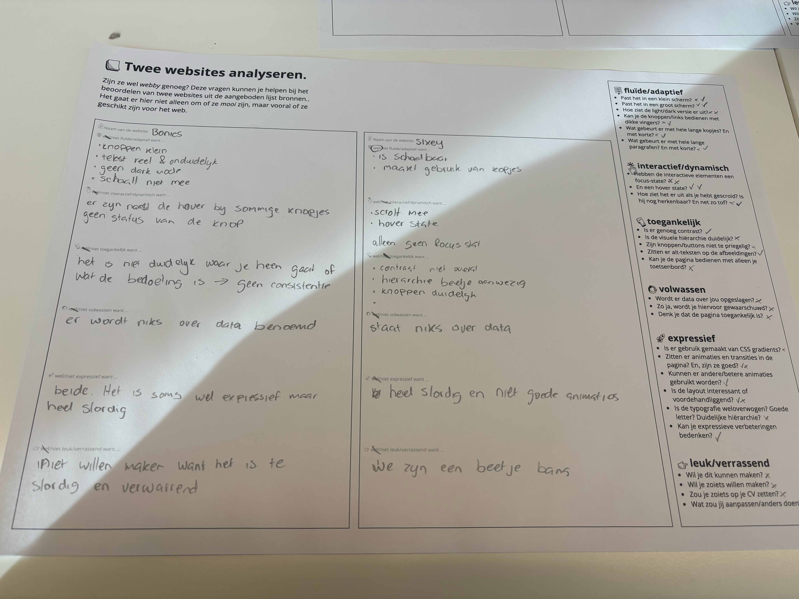
Daarna zijn we met een ander tweetal gaan bespreken welke van ons 4 de beste en slechtste websites zijn. De beste website was erg overzichtelijk en had veel ademruimte met duidelijke knoppen. De slechtste was juist rommelig en onduidelijk qua hierarchie.
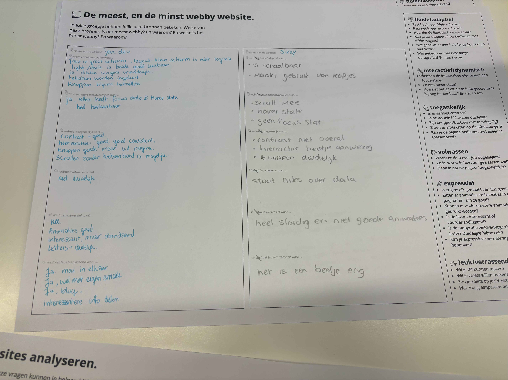

Conclusies en wat ik zou kunnen toepassen:

- Light/dark modus kan op creatieve manieren worden toegepast in plaats van alleen een knopje. Voor mijn idee dacht ik misschien een filmlicht spotlight, omdat mijn concept met films te maken heeft.
- Een focus en hover state is duidelijk voor de buttons. Maak deze buttons ook groot genoeg zodat het toegankelijk blijft voor elke gebruiker.
- Onderschrift voor afbeeldingen en buttons is belangrijk voor bijvoorbeeld slechtziende of als de website niet meer goed werkt.

**Check-out woensdag 18/11/26**

- Leg uit waar het Visual Research in 3 stappen naartoe werkt
  Stap 1: beeldverzameling: zo krijg je een idee van welke uitstraling jouw concept zal hebben.
  Stap 2: typografie: is net zo belangrijk als beeld. het bepaald welke uitstraling het zal hebben en goed kijken of het aansluit aan de beelden.
  Stap 3: hoe toepassen/crazy 8: je kijkt wat nuttig en relevant is voor je concept en hoe je het kan overzetten en dat doe je door middel van crazy8 schetsen. Zo maak je een snel begin van je concept.
- Vertel in 2 zinnen waar jouw Garden over gaat, en met welke content je dat gaat doen (beeld, tekst, sound, animatie enz).
  Mijn garden is een film archief waarbij je leert/leest over verschillende films; wat de film is, de visuals, mijn eigen mening en welke lessen je eruit kan halen. Hierbij wil ik sowieso gebruik maken van beeld en tekst met een kleine toevoeging van smalle, niet te afleidende animaties en geluid als ik daar tijd voor heb.
- Vertel kort welk idee van de Crazy 8 je het liefst zou willen uitvoeren/ verder zou willen onderzoeken.
  Mij lijkt het idee met de tv en het kiezen van de films het leukste en ik wil dat combineren met een zweverige mysterieuze dromerige sfeer. Ik zou dan nog verder willen kijken naar hoe ik die woorden in mijn schetsen en concept kan toepassen en het niet te letterlijk maken.

## **Beoordeling webby schermschetsen medestudent**

Vanuit mijn crazy8 heb ik meer schetsen gemaakt voor de mobiele versie. Hierbij heb ik meer van het zweverige en moody erin kunnen toepassen door bijvoorbeeld sterren en zwevende elementen toe te voegen (zwevende tv's, wolken). Dit hielp mij al een klein stapje verder om duidelijk een concept te kunnen neerzetten. Een medestudent heeft mij beoordeeld of mijn schetsen webby zijn. Het was lastig omdat het nog maar schetsen zijn en geen uitwerking, dus voor veel vragen moest je bedenken wat het antwoord zou zijn. De conclusie was dat ik al goede webby schetsen had en dat was erg fijn om te lezen/horen! Ik ben natuurlijk van plan om nog meer elementen toe te voegen zodat het al helemaal webby is, zoals de light/dark mode, alt tekst en duidelijke knoppen.
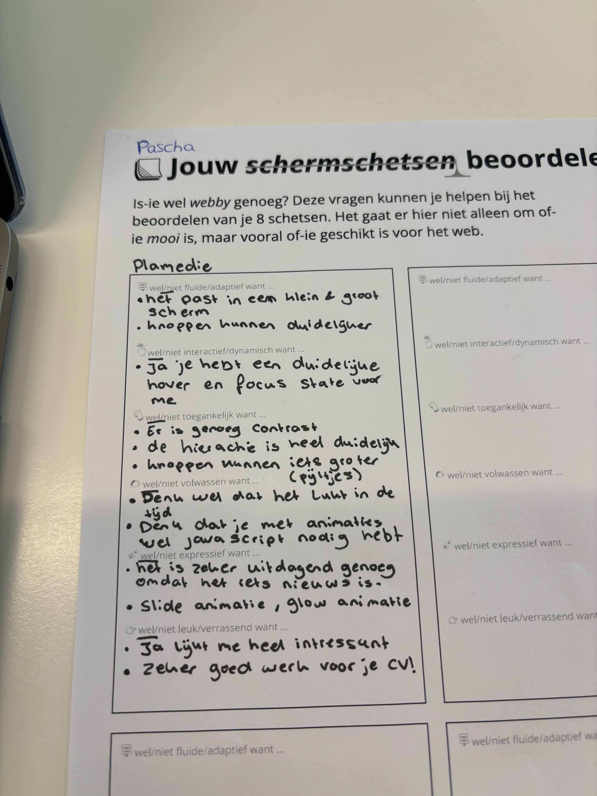

Ook heb ik gekeken naar iemand anders hun schetsen. Dit hielp mij om scherp en kritisch te blijven en met eventuele inspiratie te komen voor bijvoorbeeld de hierarchie.

Conclusies:

- Schetsen zijn duidelijk en toegankelijk
- Duidelijke speling met hierarchie

Ik wil nog verdere schetsen maken en weten wat Barbara ervan vindt.

**Feedback Barbara voor sprint 1**

- Helder concept
- Kan UL LI gebruiken
- Wolken en sterren zijn misschien te letterlijk → hert zweverige is meer passender
- Kijken naar welke fonts je kan gebruiken → gradient font is een leuk idee
- Mag afbeeldingen gebruiken maar wel met bronvermelding
- Goede hierarchie, goed dat je kan scrollen

Hoe wil ik deze feedback toepassen?

- Meer font onderzoek
- UL LI uitproberen
- Onderzoeken naar code inspiratie online
- Meer schetsen van het zweverige maken

**CSS grid**
In de les van Sanne heb ik geleerd over de grid en op wat voor verschillende manieren je het kan toepassen. Ik had al wat voorkennis omdat ik vorig jaar ook een grid had toegepast, maar het was fijn om hier meer erover te leren omdat ik het wel een belangrijk onderwerp vind als je een website maakt. Ik ben aan de slag gegaan met verschillende oefeningen, zoals een grid correct toepassen in een ontwerp. Ik merkte dat het eigenlijk wel makkelijk was, dus ik was erg opgelucht.
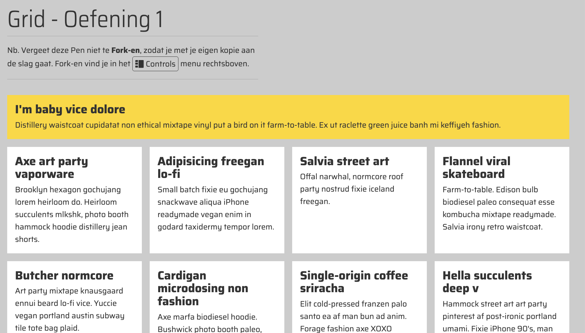
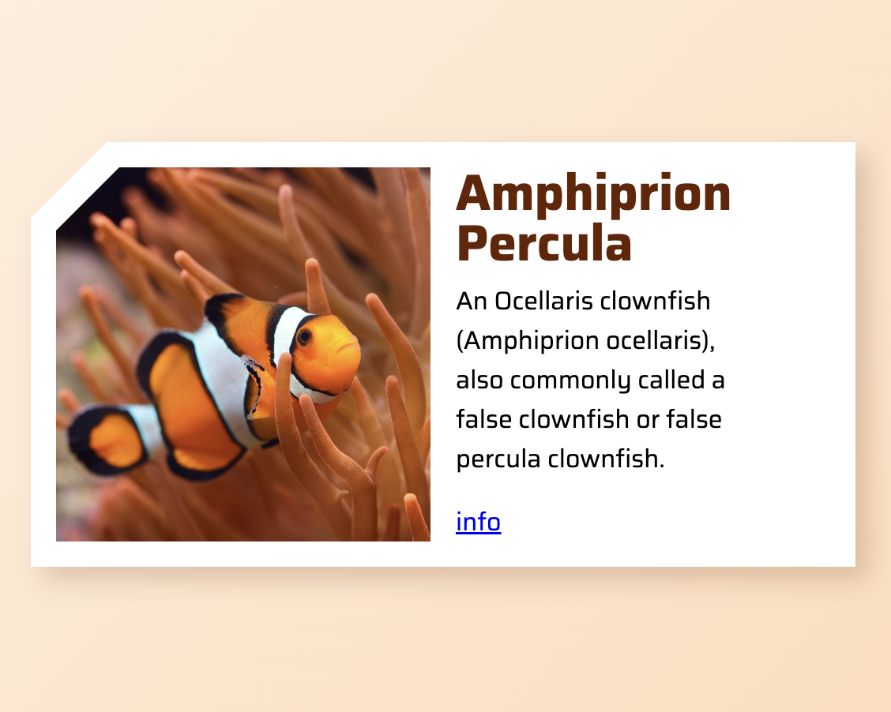
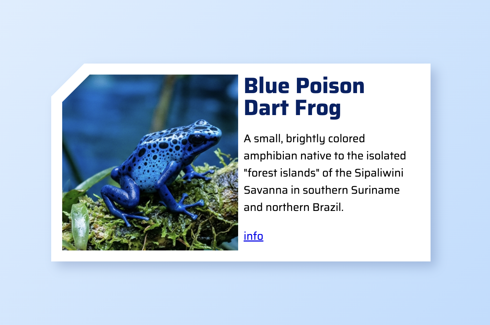
Er was daarnaast ook een game waarbij je de grid kon oefenen. Deze vond ik erg leuk omdat je op een speelse manier ook leert hoe je een grid kan toepassen en op welke verschillende manieren dat mogelijk is. Soms was het even goed nadenken en hulp vragen maar uiteindelijk ben ik ver gekomen en daarvoor ben ik trots op mijzelf!
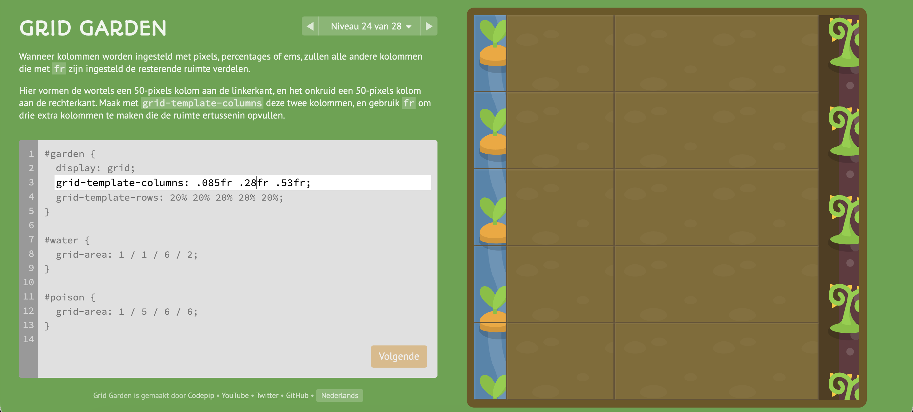

Conclusies:

- Grid kan op verschillende manieren worden toegepast
- Grid is makkelijk
- Grid maakt het overzichtelijk (wat ik wil voor mijn pagina zodat het toegankelijk blijft voor iedereen)

# **Week 3**

**Aantekeningen voorbereiding bi-weekly geek**

- Tellyhouse north is waar alle computers, kabels, cooling equipments worden geplaatst
- Bestaat ongeveer 50 jaar
- 29 oktober 1969 was het allereerste bericht gestuurd: “log in”. het crashte voordat het bij de letter g kwam
- Robert Kahn named the internet
- Internet is niet world wide web
- Request iets bekijken → video wordt in stukjes verdeeld zodat het niet crasht
- Probleem: juiste informatie onderscheiden van foutieve informatie
- AWS, microsoft azure & google cloud zijn 60% van cloud computing
- US-EAST-1 is 70% van internet traffic. het is gevoelig voor technische storingen maar ook cyber attacks, geopolitieke sabotage en terrorisme
- De publieke diensten, industriële innovatie en AI-ambities van europa zijn erg gevoelig omdat functioneert op een digitale ruggengraat die het continent niet in eigendom heeft, niet reguleert en zelfs niet volledig begrijpt
- World wide web is gecreeerd door tim berners-lee met als functie dat het door iedereen gebruikt zou kunnen worden
- Het werd erg commercieel gemaakt door Amerikanen. Hierdoor kreeg het internet een ‘profit’ design. Tim vind dit toxic
- Websites zijn niet transparant met waar je data heen gaat
- Hij is bang dat AI binnenkort niet meer goedaardig zal zijn, wat je dus niet kan controleren
