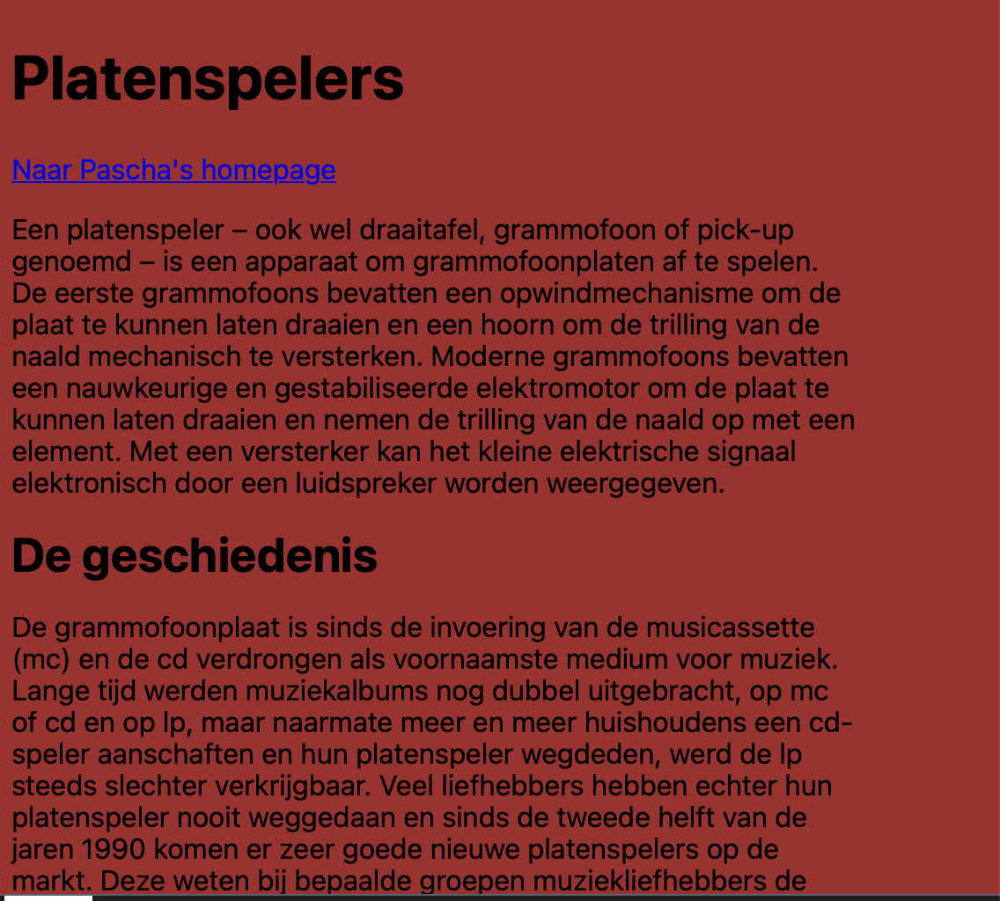
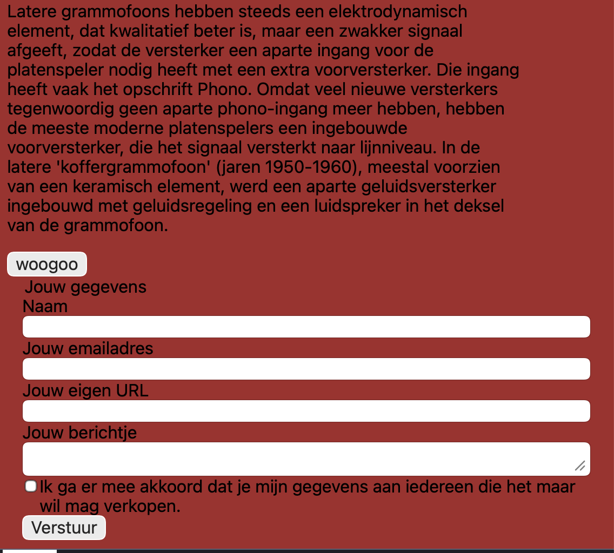
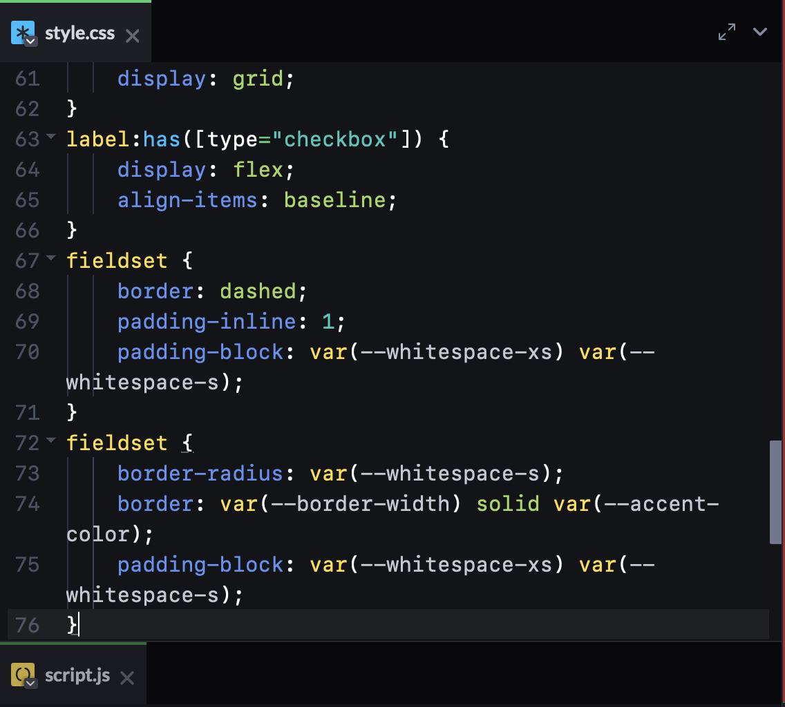
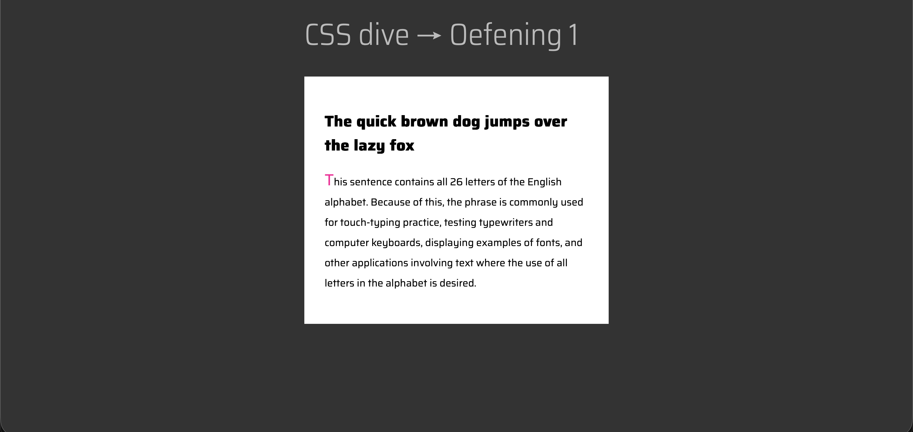
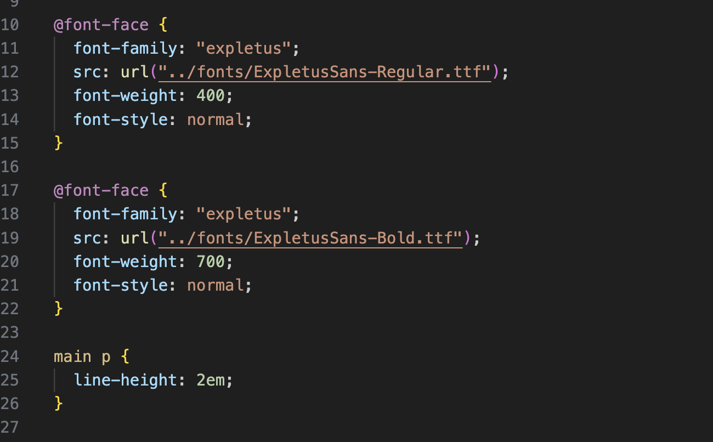
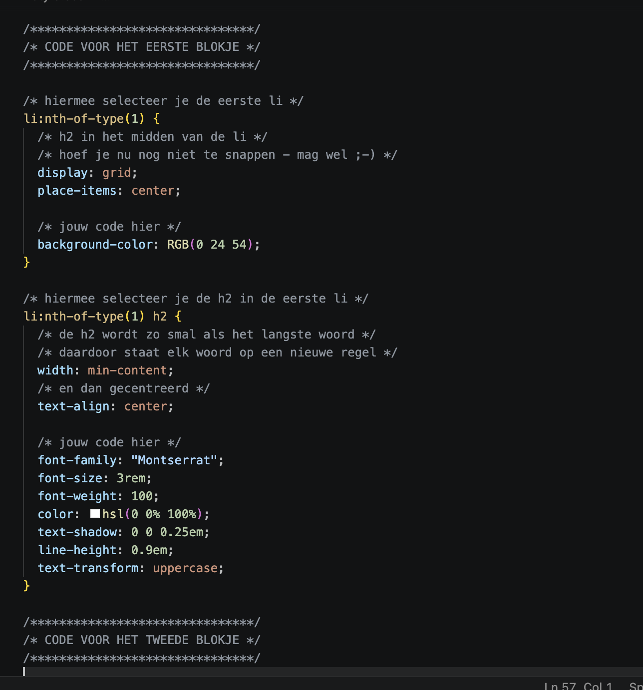
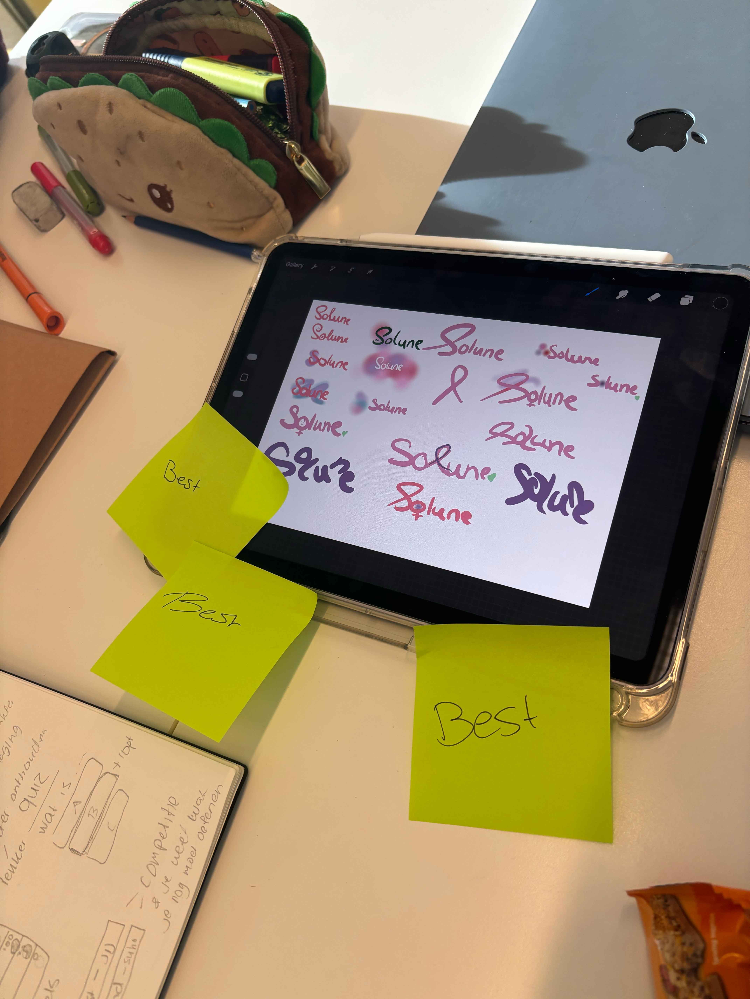
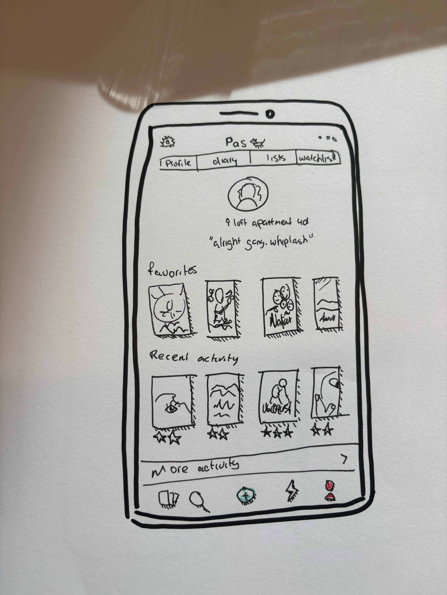
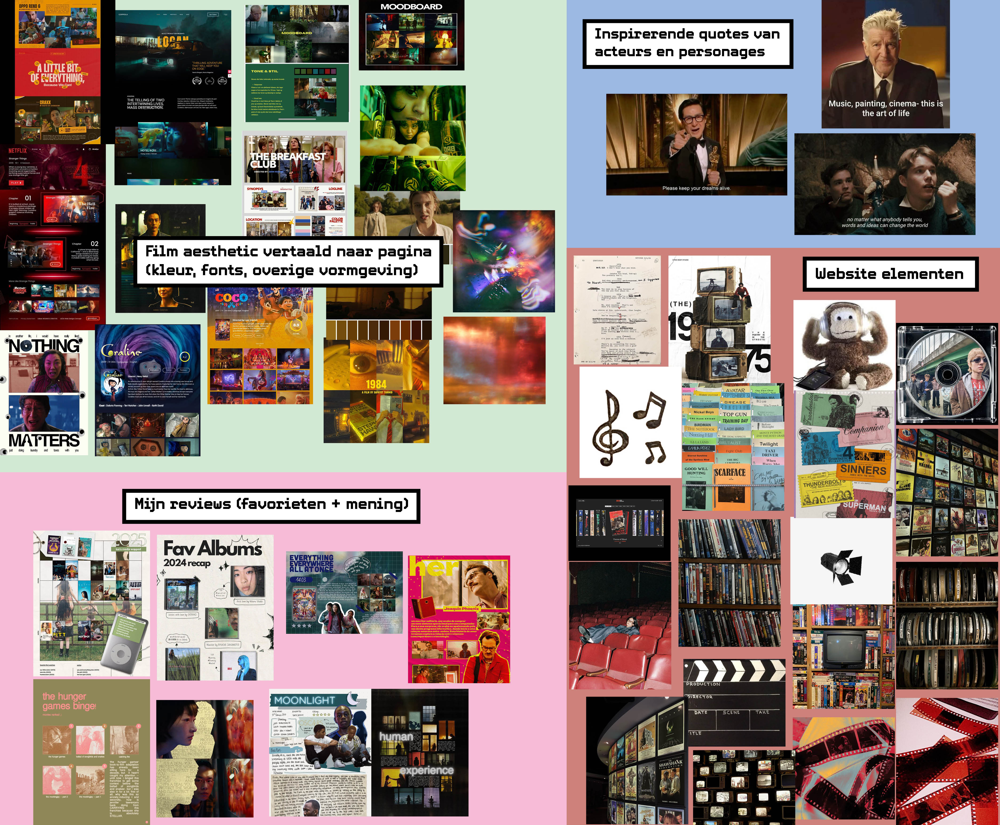

# **WEEK 1**

De checkout vragen 9/11/26:

1. Leg uit wat een source hosting platform is en voor welke jij gekozen hebt.
   Een source hosting platform is het platform waarop jouw website uiteindelijk komt te staan. Degene die ik heb gekozen is Github, omdat het gemakkelijk gaat en iedereen die gebruikt.
2. Vertel welke domeinnaam jij gekozen hebt en hoe je die hebt gekoppeld aan jouw pagina.
   Mijn domeinnaam heet 'Paschas-cottage' en die heb ik gekoppeld door middel van inloggen via Github en het koppelen met de VSCodium. Daarnaast was het ook wat gesleutel met instellingen.
3. Beschrijf hoe je aanpassingen aan jouw pagina kunt maken en hoe je er voor zorgt dat die op het web gepubliceerd worden.
   Je download sowieso de 'go-live' extension maar daarnaast zorg je er vooral voor dat je github is gekoppeld aan je VSCodium.

Lelijke pagina opdracht

Proces opdracht
De opdracht is in tweeën verdeelt; een voorbereidings onderdeel die je voor de les maakt en het onderdeel dat we samen tijdens de les hebben gedaan.
Vooraf kreeg je de opdracht om een aantal dingen in een website te doen, maar op de manier dat het niet erg prettig is om naar te kijken. Dit deed je met het programma Codepen, die gekoppeld is aan je Github account. Hierbij deed je je eigen gekozen tekst in de template (titels en broodtekst) en een afbeelding.
Tijdens de les gingen we dingen toevoegen, zoals kleur, linkjes en een invulformulier. Zo veranderde de 'lelijke' pagina naar een iets minder lelijke pagina.

Wat heb ik geleerd

- Hoe je een invul formulier toevoegt
- Hoe je iets linkt
  

Wat is handig om mee te nemen naar volgende stap:

- Hoe je een pagina mooier maakt
- Kunnen linken/formulier toevoegen (als dat bij mijn concept past)

CSS dive oefeningen
Proces opdrachten
Vooraf was het huiswerk om een code game te spelen om alvast een introductie te krijgen met het coderen en oplossen. Hierdoor kreeg ik minder het gevoel dat ik in het diepe werd gegooid en ik vond het ook nog eens een leuke oefening (wel eerst frustrerend).

Daarna waren er twee opdrachten die we tijdens de les die we samen gingen doen. Ik vind het wel fijn dat dit soort dingen in de les worden uitgelegd in plaats van dat het online maar ergens staat.
De eerste oefening was om een tekstje hetzelfde te maken. Ik vond het opzich wel te doen omdat het geen grote veranderingen waren en dus heb ik ook niet hoeven te spieken bij het voorbeeld.

De tweede oefening was ook weer om twee dingen met een titel na te maken. Dit is mij meerendeels gelukt waarbij ik soms wel moest spieken omdat ik sommige codes niet herkende.

Wat heb ik geleerd en wat ik zou kunnen toepassen

- Grote eerste letter in de tekst (uit oefening 1)
- Tekst schuin maken (uit oefening 2)
- Een glow geven aan de tekst (uit oefening 2)

Schetsen oefening
Proces opdrachten
Ter voorbereiding had ik schetsen meegenomen van eerdere blokken en liet die beoordelen door mn medestudenten met goed, mid en slechst. Ik vond het fijn om te weten wat anderen van mijn schetsen vonden.

Daarna deden we wat schetsopdrachtjes, zoals het maken van gelijke strepen en vierkanten en telefoons om te oefenen met vormen. Dit hielp mij met het uiteindelijk maken van een telefoon formaat van een zelf gekozen app. Hierbij keek je dan ook naar schaduwen en hierarchie, wat belangrijk is met het laten zien van waar de bezoeker naar kan kijken. Ik heb voor letterboxd gekozen; deze heeft een goede verdeling van tekst en afbeeldingen. Er werd ook gezegd om niet een kruis in de afbeelding te maken maar om kort de afbeelding te schetsen. Zo heb je een beter beeld bij wat de afbeelding is.

Als laatste heb ik bij de schets van een wok-menu, die ik bij Nicky's les had gemaakt, een animatie toegevoegd. Hierbij maakte ik ook weer gebruik van de kleuren en vormen en proces van hoe de animatie tot stand komt. Dit is handig om te weten als je wilt laten zien wat de animaties zijn.

Wat heb ik geleerd en kan ik meenemen naar de volgende iteratie

- Animatie schetsen
- Hoe je vierkantjes maakt (4 lijnen en niet in één lijn)
- Gebruik van hierarchie

# **WEEK 2**

De checkout vragen voor maandag 16-11-26:

1. Leg uit wat een digital garden is en waarom dat anders is dan een reguliere website.
   Een digital garden blijft zich aanpassen en is iets persoonlijks. Ook heeft het niet één doel en is voor iedereen anders en een reguliere website heeft één doel.
2. Leg uit wat een website 'webby' maakt en welke websites jou het meeste inspireren.
   Onderdelen voor een webby zijn:

- Duidelijke elementen zoals knoppen die groot genoeg zijn
- Genoeg contrast tussen de elementen en kleur
- Haalbaar en duidelijk te maken met CSS en HMTL
- Duidelijke status van de knoppen

3. Vertel waar jij mee aan de slag wilt gaan bij het maken van jouw eigen digital garden (let op: dit zijn jouw eerste ideeën, dit kan en mag veranderen in de loop van het programma)
   Mijn eerste idee gaat over het universum en dat je op de planeten kan klikken en dat je dan informatie krijgt met een thema
   Mijn tweede idee gaat over films en dat je dan een film kan uitkiezen en dat dan de hele pagina die sfeer van die film wordt. Hierbij schrijf ik dan ook mijn mening over de film en de lessen die ik eruit haal.

**Presentatie en vragenlijst:**
Ik had een presentatie gemaakt over mijn concept (het filmarchief) zodat ik dit kon presenteren aan een medestudenten zodat ik kan oefenen om over mijn concept te vertellen. (zie mapje oefeningen)
Hiervoor heb ik mijn concept onderverdeelt in alle onderdelen die ik wilde benoemen:

- Film aesthetic vertaald
- Inspirerende quotes
- Mijn reviews
- Website elementen

**Eigen verbinding:**

- Heeft 'de ander' een aanvulling op je onderwerp?
  zie het al helemaal voor me, dus goed uitgelegd. ook leuk dat je niet alleen beeld willen gebruiken maar ook geluid. Misschien ook vergelijkbare films laten zien als je eentje hebt gekozen.
- Wat is het karakter/ de uitstraling/ het gevoel dat bij het onderwerp past? (bijv. stoer, hip, vrolijk, dynamisch, eenvoudig, enz.)
  nostalgisch, old cinema/hollywood maar ook sfeervol door alle elementen. Ook moody door de ambience.
- Welke inspiratie kun je uit je 25 afbeeldingen halen. Stijl, een gevoel, vorm, enz.
  het oude terugbrengen voor homepagina en als je dan op de film klikt dat het dan de ambience veranderd. filmrol of spotlight op homepagina houden.
  **Een stip op de horizon**
- Wat zou je willen vertellen over het onderwerp aan een ander? en hoe zou je dat voor je kunnen zien? middels welke beeld, tekst, animatie, inhoudelijke content? (bijv. Ik wil voornamelijk afbeeldingen tonen, als een soort Pinterest, of ik wil muziek fragmenten laten horen, of ik gebruik korte teksten met eigen foto's).
- Vul deze zin aan:Ik wil mijn Digital Garden laten gaan over een film archief met de film ambience en wil dat laten zien door bijpassende kleuren, fonts, afbeeldingen en andere grafische elementen aan content te tonen. Ik begin met een stukje eigen content over films en mijn eigen favorieten. Als het begin is gemaakt kan ik mijn Garden verder uitbreiden door de persoonlijke ambience pagina’s te maken met belangrijke punten die je uit de film kunt halen.

Conclusies

- Onderwerp duidelijk voor de andere
- Voelt moody en dromerig

geinspirereerd → concept: filmarchief → allerlei lessen en inspiratie die je uit films kan halen
emotioneel → concept: filmarchief → films brengen allemaal emoties naar voren
dromerig → films hebben een grote fantasie, van het idee tot de uitwerking van de look-en-feel
artistiek → films zijn heel expressief met hun kunsten

Uiteindelijk kies ik voor dromerig omdat het het beste uitlegt wat voor sfeer films geven: het zijn zoveel gekke verhalen net zoals degene die je in je dromen krijgt. Daarnaast zijn films ook magisch zoals dromen.

**Miro presentatie visual research bord**
Ik heb visual research gedaan naar mijn gekozen concept. Ik
